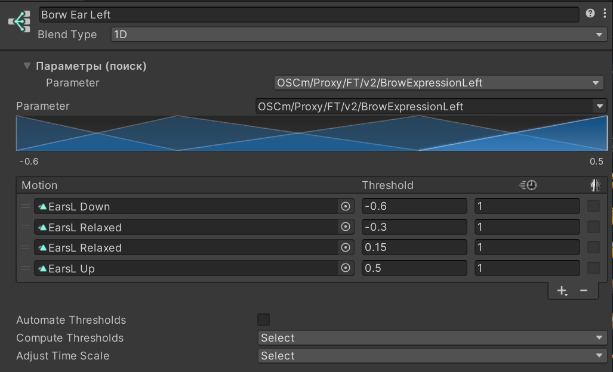
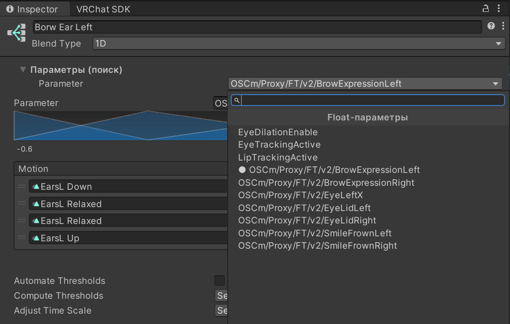

# [ArVi] Blend Tree Param Picker

Добавляет над стандартным инспектором Blend Tree блок **«Параметры (поиск)»**: плоский список Float-параметров контроллера с полем поиска вместо вложенных подменю по `/`. Поиск по словам через пробел — `proxy brow left`.

Клик по полю открывает список всех Float-параметров контроллера одним уровнем, с поиском сверху. Текущий параметр отмечен точкой.

- Работает для 1D, 2D (Simple Directional, Freeform Directional, Freeform Cartesian) и Direct.
- Параметры, которых нет в контроллере, подсвечиваются.
- Стандартный инспектор остаётся на месте без изменений.

Часть пака [ArVi VRC Tools](https://github.com/UndefinedSignal/arvi-vrc-tools).
