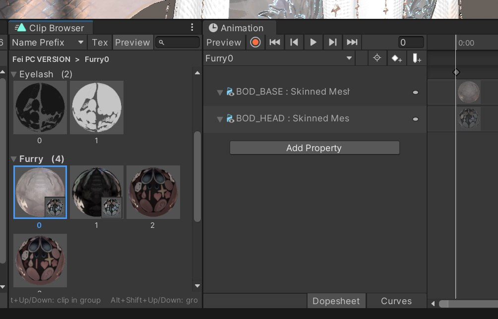

# [ArVi] Clip Browser

Удобный переключатель клипов для окна Animation.

Открыть: **Window > Animation > Clip Browser**.

Плитки показывают превью материала, который включает клип; клик по плитке сразу переключает клип в окне Animation.

- Группировка клипов по префиксу имени, по слою аниматора или по папке.
- Превью плиток, поиск, избранное.
- Хоткеи (меняются в **Edit > Shortcuts > Clip Browser**):
  - `Alt+↓` / `Alt+↑` — следующий / предыдущий клип в группе
  - `Alt+Shift+↓` / `Alt+Shift+↑` — следующая / предыдущая группа
  - работают даже без открытого окна

Часть пака [ArVi VRC Tools](https://github.com/UndefinedSignal/arvi-vrc-tools).
