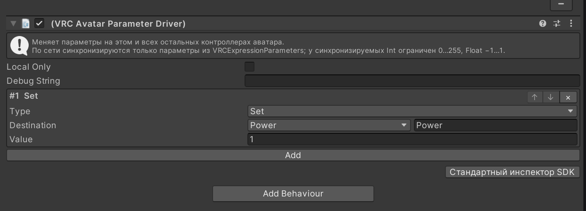
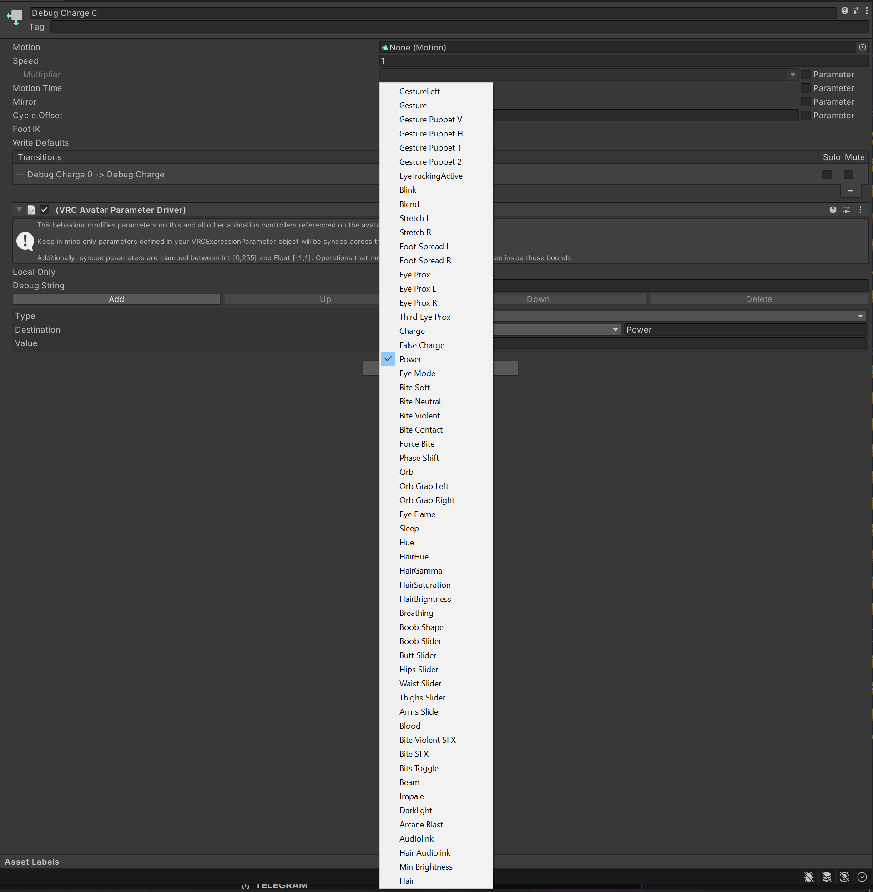
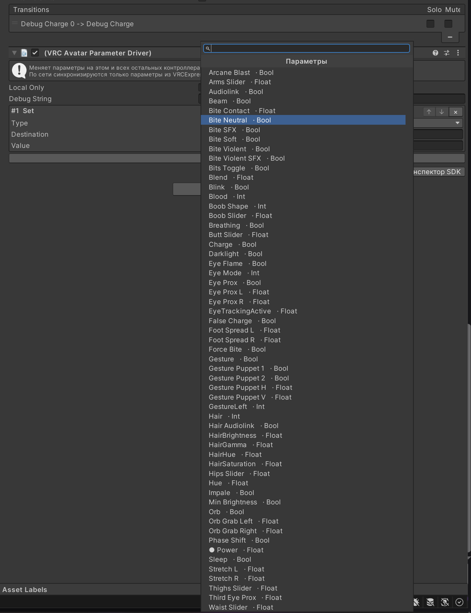

# [ArVi] Parameter Driver Picker

Заменяет инспектор **VRC Avatar Parameter Driver**: поля **Destination** и **Source** открывают плоский список параметров контроллера с полем поиска вместо огромного нативного попапа. Поиск по словам через пробел, тип параметра тоже участвует — `float hair`, `bool bite`.

## Было / стало

| Было — нативный попап SDK со всеми параметрами подряд | Стало — плоский список с поиском и типами |
|---|---|
|  |  |

## Возможности

- Работает для Set, Add, Random и Copy (у Copy — и Source, и Destination).
- Рядом с каждым параметром в списке виден его тип, текущий отмечен точкой.
- Справа от кнопки остаётся текстовое поле — имя можно вписать вручную.
- Параметры, которых нет в контроллере, подсвечиваются.
- Все записи драйвера видны сразу, у каждой кнопки ↑ ↓ ×.
- Кнопка **«Стандартный инспектор SDK»** внизу возвращает инспектор VRChat, если он нужен.

Требует VRChat Avatars SDK (`com.vrchat.avatars`).

Часть пака [ArVi VRC Tools](https://github.com/UndefinedSignal/arvi-vrc-tools).
